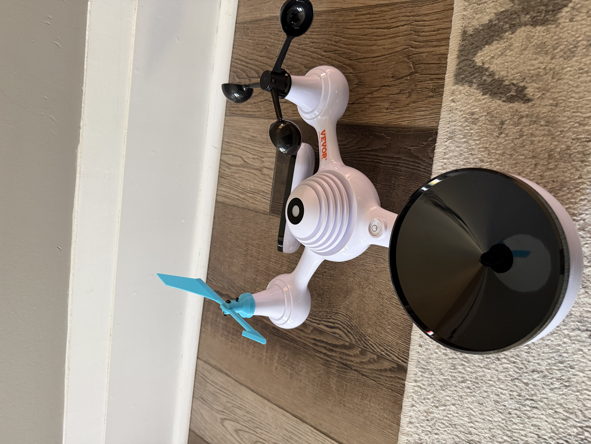
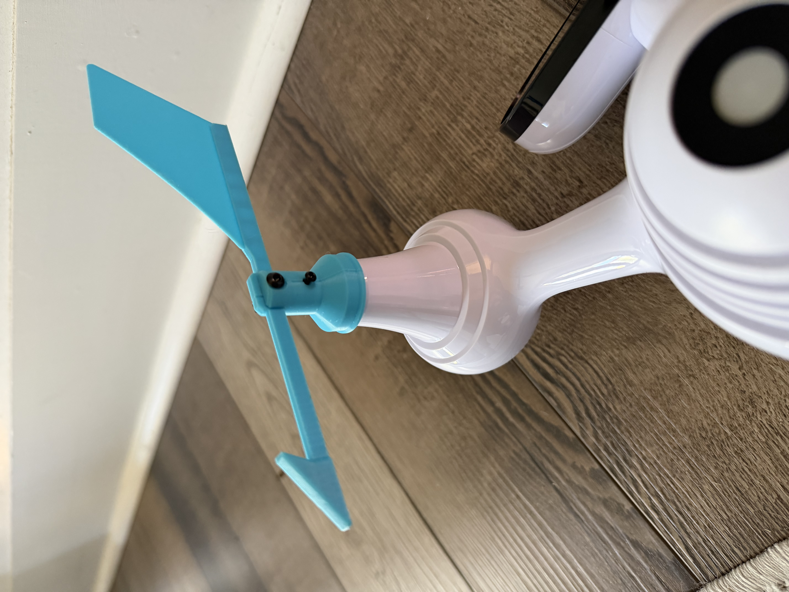
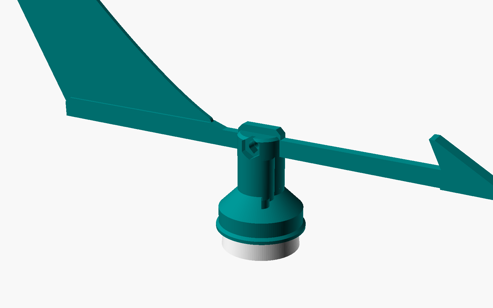
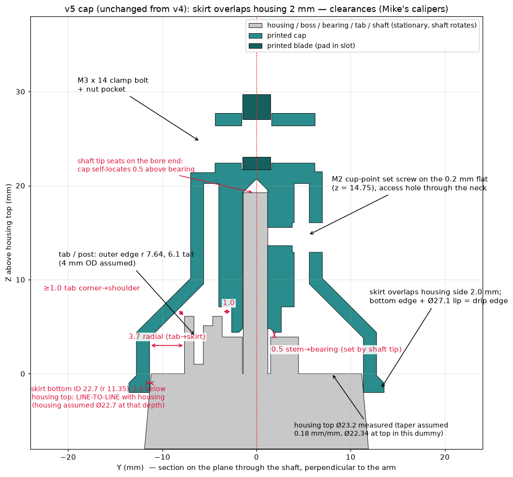
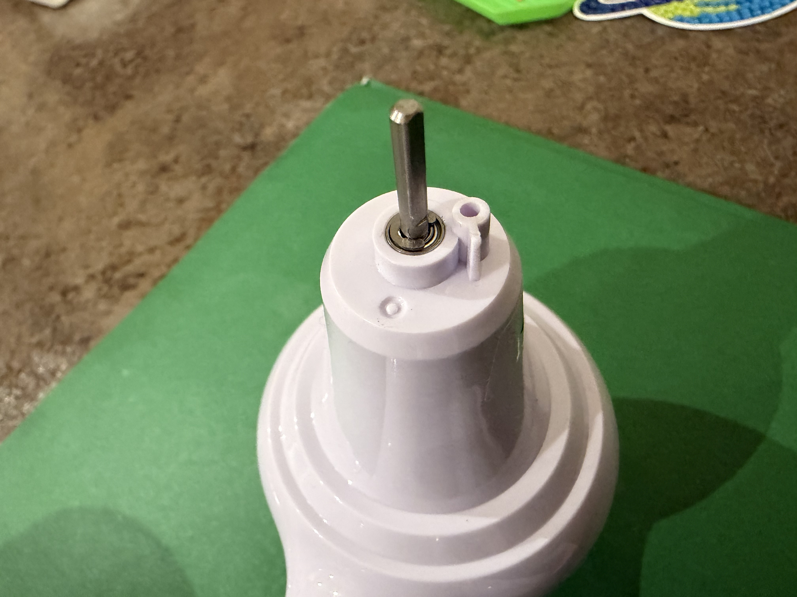

# Replacement wind vane for the VEVOR YT60231

A two-part 3D-printed replacement wind-direction vane for the **VEVOR YT60231** 7-in-1 weather station (and rebrands that use the same sensor head). It is a cap that slides onto the 2.8 mm D-shaft and locks with a set screw, plus a blade that bolts to the cap.

This is **v5**: no ballast hardware, a solid printed barbed arrow, and a slightly shorter tail. Earlier versions are in `variants/`.



| | |
|---|---|
|  |  |
|  |  |

**What's new in v5** (v4 is saved in `variants/v4_teardrop/`, v3 in `variants/v3_final/`):
- **No ballast hardware.** The nut pod and the 2 × M6 nuts are gone. A vane on a vertical shaft doesn't need to be statically balanced to point into the wind. The original is tail-heavy too, with its CG about 28 mm behind the shaft (estimate).
- **Solid printed barbed arrow.** It's 22 mm long, rises 8 mm above the arm, and is 5 mm thick (the arm is 3 mm). The back edge of the barb sweeps forward 4 mm (27° from vertical, so it prints without support). It carries a little more material out front than the original's thin half-barb.
- **Tail 3 mm shorter** (97 mm to the fin's top trailing corner), which brings the CG in to about **16 mm behind the shaft** at normal infill.
- **Unchanged from v4:** cap, M3 joint, skirt (bottom ID 22.7, 2 mm overlap, drip edge), self-locating bore and fit ring.

The hub works like the original's: **a cap**. The arm sits on top of the hub. A bell-shaped skirt drops over the bearing boss and the small tab/post, and a drip lip at the bottom edge sheds water before it can reach the shaft or bearing. The blade keeps the profile measured from VEVOR's photos (barbed arrow, tall swept fin) and is **167.6 mm long**.

## Why two printed parts
In the installed position the arm sits at the top of the cap and the fin rises above the arm, so no single orientation prints without supports:
- **Upright:** the 170 mm arm floats about 23 mm above the bed.
- **Upside down:** the fin would hang below the bed.
- **On its side:** the round cap and skirt need support, and the off-centre blade would unbalance it sideways.

So it splits into two parts, each printed in its natural support-free orientation:

| Part | File | Print orientation | Notes |
|---|---|---|---|
| **Cap** (hub, skirt, drip lip, bore, set screw) | `stl/wind_vane_cap.stl` | **Upside down**: the cap top with its slot sits on the bed and the skirt opens upward | No supports. The skirt shoulder is 45°, the drip lip has a 45° flare, the bore is vertical, and the horizontal holes are teardrops. The slot floor is a 3.2 mm bridge. |
| **Blade** (arm, barbed arrow, fin, centre pad) | `stl/wind_vane_blade.stl` | **Upright**: arm on the bed, fin standing up, same as v2 | No supports. The bolt hole through the pad is a teardrop. |

**Joint:** the blade's 3 mm centre pad drops 6 mm into a keyed slot across the cap top (along the arm), which fixes the angle. One **M3 × 14 screw and M3 nut** clamp it through both cheeks and the pad. The nut sits in a hex pocket on the −Y cheek; the head seats on a flat spot face on the +Y cheek. No glue is needed, though a drop of CA or epoxy in the slot is fine. This keeps the parts small and strong: the fin's layers stand vertical and the cap's skirt prints as clean walls.

## Files
- **Model:** `source/wind_vane.scad` – parametric. `part=` can be `"assembly"`, `"cap_print"`, `"blade_print"`, `"cap"`, `"blade"`, `"fit_ring"`, `"housing"` (dummy of the sensor top), `"envelope"` or `"section"`.
- **STLs:**
  - `stl/wind_vane_cap.stl` and `stl/wind_vane_blade.stl` – print-ready, in print orientation, each watertight and one body
  - `stl/wind_vane_assembly_installed.stl` – both parts in installed position, for reference only
  - `stl/wind_vane_skirt_fit_ring.stl` – 4 mm tall test ring (skirt bottom ID 22.7, OD 25.5), 0.5 g
- **STEPs:** `step/wind_vane_cap.step`, `step/wind_vane_blade.step` and `step/wind_vane_assembly.step`, all in installed coordinates (z = 0 at the housing top). They're made by `wind_vane_cq.py` and their volumes match the STLs to within 0.2 %.
- **Previews:**
  - `preview_cap_section_clearances.png` – dimensioned cross-section of the cap over the boss and tab
  - `preview_iso.png`, `preview_side.png`, `preview_iso_on_housing.png`, `preview_arrow.png` (close-up of the arrow)
  - v3 previews (exploded, print layout, cap underside, top) are in `variants/v3_final/`. The layout hasn't changed.
- `compare.png` – original vs. v4 vs. v5, all at the same scale
- **Scripts:**
  - `balance.py` – CG and side-area moments at normal infill
  - `mass_model.py` – per-layer FDM mass model: walls and top/bottom skins solid, the rest at the infill percentage
  - `clearance.py` – minimum clearance between the cap and the swept stationary parts
  - `check.py` – STL validation
  - `section_plot.py`
- `variants/v4_teardrop/` (balanced v4 with nuts), `variants/v3_final/` (v3 as printed), `variants/v3_estimates/` (v3 built on photo estimates), `variants/v2_flat_hub/` and `variants/v1_big_arrow/` – earlier versions.

## Sensor-top dimensions (caliper measurements of a VEVOR YT60231, 2026-11-20)
| Ref | Measurement | Parameter |
|---|---|---|
| A | across-flat 2.6 | `flat_depth = 0.2` (2.8 − 2.6). **Shallow flat**; see Notes. |
| B | boss OD 8.92 | `boss_d = 8.92` |
| C | far side of boss → tab outer edge 12.1 | `tab_outer_r = 12.1 − 8.92/2 = 7.64` |
| D | tab height 6.1 | `tab_h = 6.1` |
| E | shaft above bearing 15.35 | `shaft_protrusion = 15.35` |
| F | housing top Ø23.2 ("with room to spare"; the housing tapers, wider going down) | `housing_top_d = 23.2` → `skirt_bottom_id = 22.7` (F − 0.5), `skirt_overlap = 2.0` |
| G | boss height 3.9 | `boss_h = 3.9` |
| – | tab OD **not measured** (4 assumed) | `tab_d = 4`. This sets how far the tab reaches toward the shaft (r ≈ 3.64). |

After any change, re-export and run `python clearance.py` and `python balance.py` (commands at the end).

## Key dimensions (v5, as built; the cap is the same as v4)
- **Cap:**
  - Neck Ø14, walls 1.4 mm.
  - **Skirt: bottom ID 22.70, OD 25.50, small 45° drip lip to Ø27.1** at the bottom edge.
  - The skirt is a straight cylinder from its bottom edge, **2.0 mm below the housing top plane**, up to 3.8 mm above it. From there a 45° shoulder runs in to the neck.
  - The cap top is 27.7 mm above the housing top. The cap is 29.7 mm tall.
- **Bore:**
  - Ø2.95 round, **2.65 across the flat**, 14.85 deep. The shaft tip seats on the bore end, which puts the stem bottom **0.5 mm above the bearing**.
  - Closed top with a cone roof.
- **Stepped core:** an r 2.64 stem up to z 7.1 (clears the tab's inner side), then Ø8.
- **Set screw:** M2 **cup point** at z 14.75 (4.5 mm below the shaft tip), centred on the flat. There's a Ø2.6 access hole through the neck. Optional second screw: `second_screw_dz`.
- **Clearances** (`clearance.py`, full 360° sweep of the boss, bearing, tab and tapered housing):

| Gap | Clearance |
|---|---|
| **Skirt bottom ID to housing side at −2 mm** | **0.00, line-to-line by spec.** The housing is assumed to be exactly Ø22.7 at that depth. See the warning below. |
| Skirt wall to housing top edge (z = 0) | 0.18 radial (with the assumed 0.18 mm/mm taper) |
| Skirt to tab outer edge | 3.7 radial |
| Shoulder to tab top corner | ≥1.0 |
| Stem to tab inner side | 1.0 |
| Stem to bearing | 0.5 |

- **Blade:**
  - **Arm:** 3 × 5 mm.
  - **Nose:** 72 mm from the shaft to the arrow tip. The **solid barbed arrowhead** is 22 × 13 mm in side view (barb top 8 mm above the arm) and 5 mm thick.
  - **Tail:** **97 mm** to the fin's top trailing corner, 74 mm at the bottom.
  - **Fin:** 45 mm tall, 33 mm top chord, 1.4 mm thick, concave leading edge from 11 mm behind the shaft.
  - **Centre pad and M3 joint:** unchanged.
- **Overall:** **167.6 mm long** (v4 170.6). The fin top is 66.7 mm above the housing top.

### ⚠ Skirt fit
A spinning vane must not touch anything stationary. A 22.7 mm skirt that touches the housing will add drag and make the vane stick in light wind.
- **Molding eccentricity and print tolerance:** printed holes usually come out 0.1–0.2 mm small, and the shaft is rarely perfectly concentric with the housing.
- **Taper:** the product photo suggests the housing grows about 0.18 mm in diameter per mm going down, but nobody has measured that.

**Before printing the cap, print `stl/wind_vane_skirt_fit_ring.stl`** (5 min). Slip it over the housing top. It should drop 2 mm below the top edge with a visible gap all round. If it binds or is snug, raise `skirt_rim_clear` (e.g. 0.25 → ID 23.2) or reduce `skirt_overlap`, then re-export. Each 0.1 mm of `skirt_rim_clear` adds 0.2 mm to the ID.

## Balance, mass and pointing authority
v5 is **deliberately tail-heavy**, like the original. On a vertical shaft, static balance doesn't affect where the vane points; wind on the fin does. Being off-balance only matters if the sensor isn't level: the heavy tail then tends to swing to the low side in a dead calm. So mount it level.

**Mass and CG** (from `balance.py`, which slices the parts at 0.2 mm layers with 0.45 mm walls and 4 top/bottom layers; PETG at 1.27 g/cm³). Hardware means the M3 × 14 screw, M3 nut and M2 set screw, about 1.35 g, all on the axis.

| Print settings | Blade | Cap | Tail moment | CG, plastic only | **CG incl. hardware** |
|---|---|---|---|---|---|
| 30 % infill, 2 walls | 5.94 g | 3.94 g | −183.6 g·mm | 18.6 mm behind | **16.4 mm behind** |
| **35 % infill, 2 walls** | **5.99 g** | **3.96 g** | −183.3 g·mm | 18.4 mm behind | **16.2 mm behind** |
| 40 % infill, 3 walls | 6.47 g | 4.16 g | −184.3 g·mm | 17.3 mm behind | **15.4 mm behind** |
| 100 % (solid, reference) | 6.71 g | 4.21 g | −179.1 g·mm | 16.4 mm behind | 14.6 mm behind |

- **Total vane ≈ 11.3 g** at 35 % (≈ 9.5 g in ASA). v4 was about 18.8 g with its nuts.
- **Infill makes little difference.** The tail moment only moves about 1 g·mm across normal settings because the thin fin and arm print solid anyway. Any normal profile lands at 15–17 mm, well inside the original's ~28 mm.

**Pointing authority:** side (XZ) projected area × lever arm about the shaft. The cap is symmetric, so it adds nothing.

| | Nose area | Nose moment | Tail area | Tail moment | Tail : nose |
|---|---|---|---|---|---|
| Original (photo-measured profile) | 4.1 cm² | 14.6 cm³ | 22.4 cm² | 132.0 cm³ | ≈ 9.0 : 1 |
| v4 (teardrop pod) | 5.2 cm² | 18.3 cm³ | 22.4 cm² | 132.0 cm³ | 7.2 : 1 |
| **v5** | **4.1 cm²** | **14.9 cm³** | **21.7 cm²** | **123.7 cm³** | **8.3 : 1** |

The v5 tail centroid is 56.9 mm behind the shaft and the nose centroid 36.2 mm ahead. That keeps 94 % of the original's tail moment, so it still weathervanes strongly.

## Notes on the shallow 0.2 mm flat
- **The flat is only 1.44 mm wide.** An M2 **cup-point** set screw (point Ø ≈1.0 mm) fits on it. Don't use M2.5 (point too wide) or a flat-point screw.
- **Before final tightening,** mark the screw position and make a small **dimple, about 0.3 mm deep, on the flat with a Ø1.5 drill**, 4.5 mm below the shaft tip. The cup point then locks positively. Add a drop of medium threadlocker.
- **Alternatively, file the upper 6 mm of the flat** down to about 2.4 mm across-flat. Leave `flat_depth` at 0.2 so the bore still fits the untouched lower shaft.
- **Second screw option:** `second_screw_dz = -3.5` adds a second screw on the same flat if the flat runs far enough down.
- **The D-bore flat is snug (+0.05 mm).** Printed holes run slightly small. If the shaft won't go in, scrape the bore's flat side with a needle file or a 2.5 mm flat blade. If it's very loose, the set screw still does the locking.

## Print settings (normal settings, no special infill)
- **Material:** PETG or ASA, 0.4 mm nozzle, 0.2 mm layers (0.12–0.16 gives a rounder bore).
- **Shells and infill:** **2–3 walls, 4 top / 4 bottom layers, 30–40 % gyroid** for both parts. **No supports.**
- **Cap:** upside down as exported. The skirt's bottom edge and drip lip print last at the top: vertical wall plus a 45° flare.
- **Blade:** as exported, arm on the bed and fin standing up. A 3–5 mm brim is optional. Slow the top of the fin (min layer time ~8 s).
- **Fit ring:** print it first, upright.

## Assembly
**Hardware:**
- 1 × M3 × 14 screw (stainless)
- 1 × M3 hex nut
- 1 × M2 × 3 cup-point set screw (stainless; an M2 × 4 also fits)

No ballast is needed.

1. **Join the parts:** push the blade pad into the cap slot (arrow on the +X side). Put the M3 nut in the hex pocket and insert the M3 × 14 screw from the spot-face side. Snug it down.
2. **Clean up the bore** with a 2.8–3.0 mm drill turned by hand.
3. **Start the set screw:** thread an M2 × 3 cup-point stainless set screw (×3 seats it on the flat inside the core; ×4 also fits) through the neck access hole into the core so it cuts its own thread, then back it out to clear the bore.
4. **Fit it on the shaft:** slide the cap down until the **shaft tip bottoms out in the bore**. That sets the 0.5 mm gap above the bearing and puts the skirt edge 2 mm below the housing top. Turn the cap so the access hole faces the shaft flat and tighten the set screw. Spin it by hand: it must turn freely and coast. If the skirt drags on the housing, see the skirt-fit warning above.
5. **Calibrate direction:** the flat and screw sit 90° from the arrow (`screw_angle`). Calibrate against north or the original. Mount level, per the manual.

## Regenerate
```
openscad -o stl/wind_vane_cap.stl   -D 'part="cap_print"'   source/wind_vane.scad
openscad -o stl/wind_vane_blade.stl -D 'part="blade_print"' source/wind_vane.scad
openscad -o stl/wind_vane_skirt_fit_ring.stl -D 'part="fit_ring"' source/wind_vane.scad
openscad -o stl/wind_vane_assembly_installed.stl -D 'part="assembly"' source/wind_vane.scad
python source/clearance.py && python source/balance.py && python source/wind_vane_cq.py
```

## License

[CC BY 4.0](LICENSE). Please credit the author if you share or remix this design.

VEVOR is a trademark of its owner. This is an independent replacement part, not an official VEVOR product.
